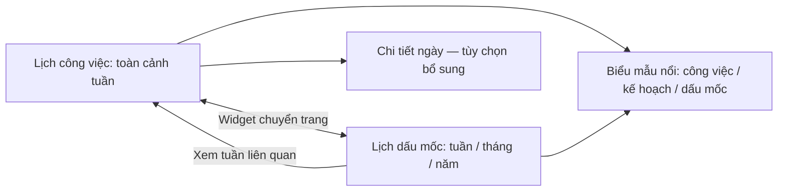
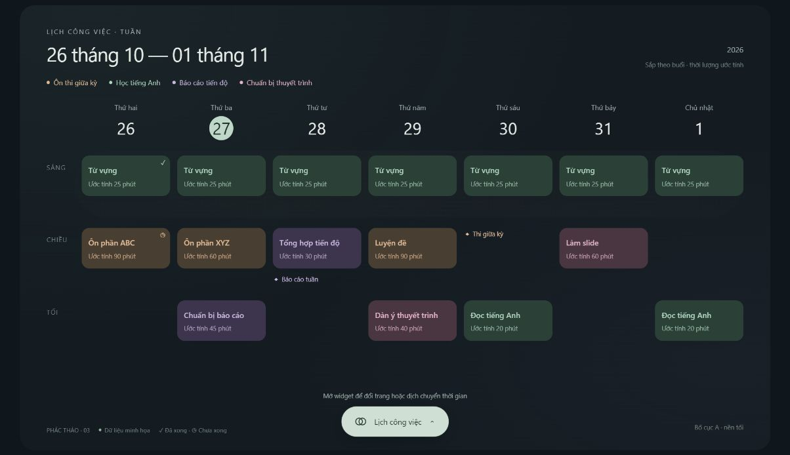
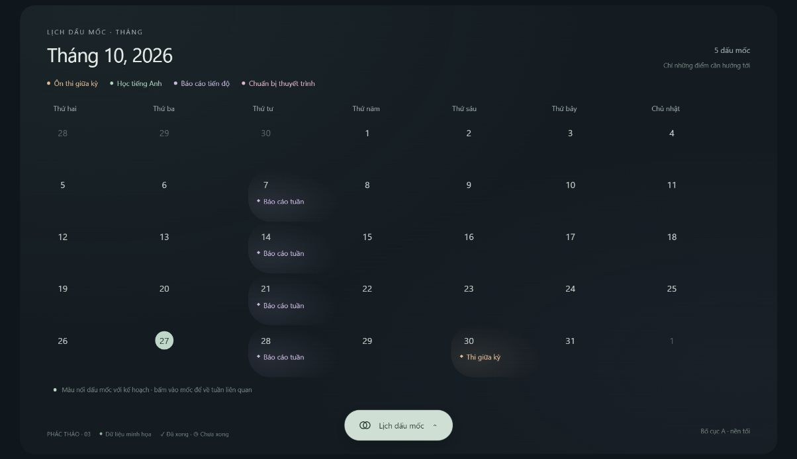
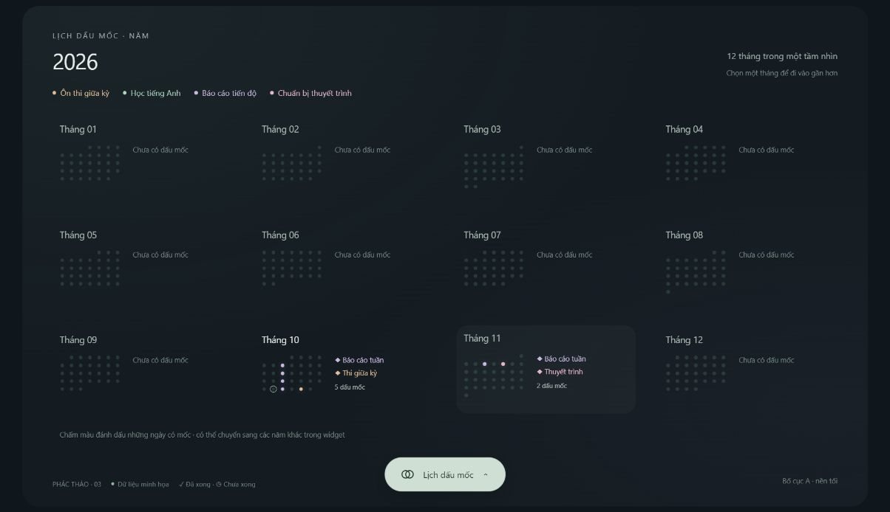
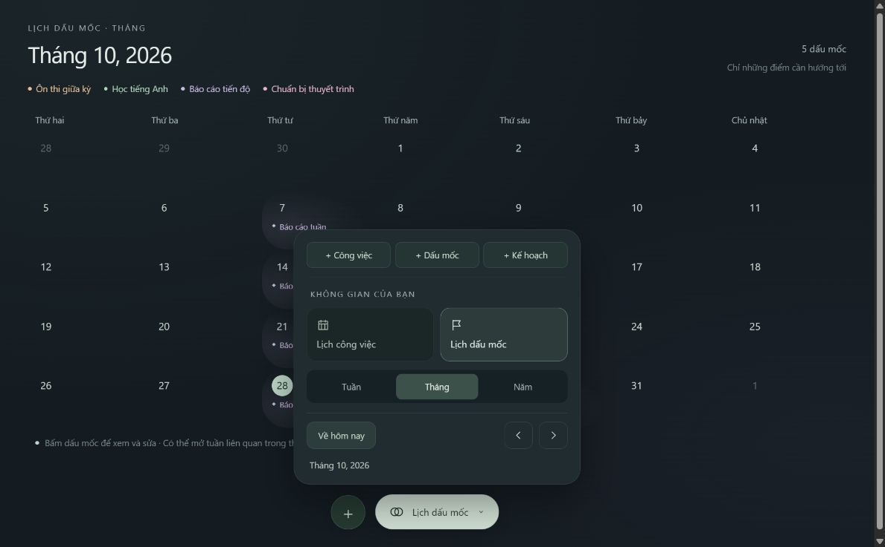
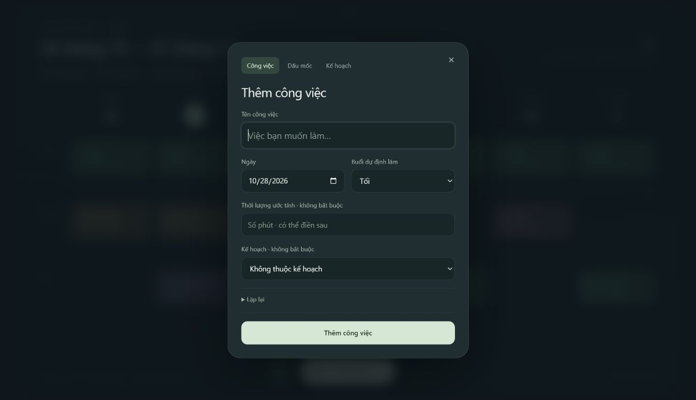
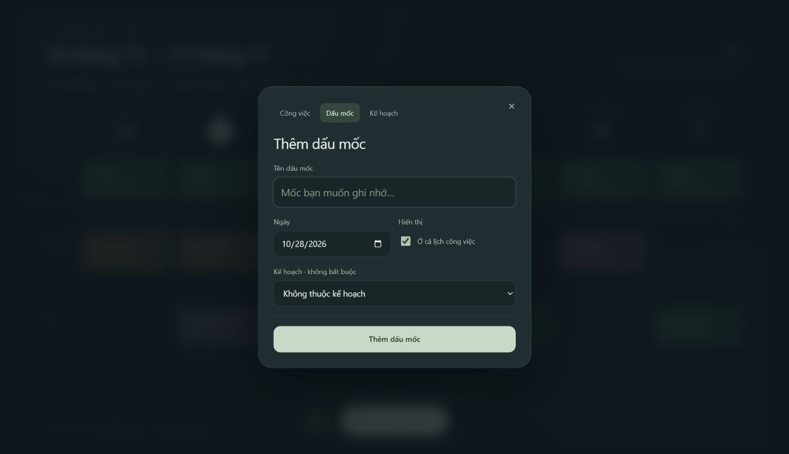
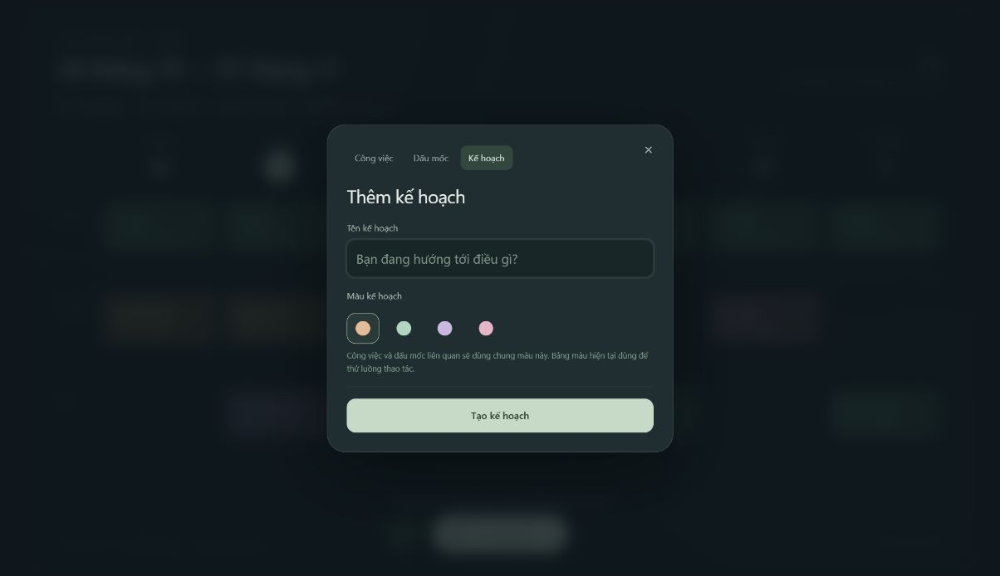

# DAYFORGE — giao diện và tương tác

Trạng thái ngày **28/10/2026**: **T01 và [đặc tả T02 1.0](../tasks/t02/design.md) đã được duyệt, cả hai task hoàn thành; T03 chưa thực hiện, chưa xây code sản phẩm.** Người dùng chốt T02 bằng xác nhận “được rồi chốt T02”, gồm các mặc định người thiết kế đã gom theo ủy quyền. Tài liệu này tóm lược UX; lấy thông số/hành vi hiện hành từ đặc tả T02, lịch sử trao đổi giữ trong README của task.

## 1. Hướng thị giác đã chọn

- Bố cục **A — tuần mở**, phối **nền tối của hướng B**.
- Lịch là nội dung trung tâm; dùng khoảng trống, nhịp chữ và các mốc ngày để tổ chức giao diện.
- Hạn chế đường kẻ và khung ô nặng; công việc hiện thành những thẻ gọn, có nhấn màu theo kế hoạch.
- Không có header hoặc sidebar cố định. Tên trang, khoảng ngày và ngữ cảnh có thể hiện nhẹ trong vùng nội dung; không cần một thanh chrome riêng.
- Công cụ nằm trong widget nổi nhỏ, chỉ mở rộng khi dùng.
- Chuyển động hiện đại, mượt, có điểm nhấn nhưng không lặp lại để trang trí trong lúc người dùng đọc lịch.

Tên **DAYFORGE** là nhận diện sản phẩm. Không tự đổi hướng sang phong cách lửa, kim loại hoặc hiệu ứng rèn chỉ dựa vào tên; hướng tối, tinh tế đã chọn vẫn là cơ sở.

## 2. Hai không gian chính

Hai lịch có chung ngôn ngữ thị giác và chung dữ liệu liên quan. Trong T02, người dùng đã chọn **mỗi lịch nhớ khoảng thời gian vừa xem riêng**: đổi trang thông thường không đồng bộ mốc ngày giữa hai lịch. Đề xuất giữ thêm quy mô dấu mốc và vị trí cuộn riêng. “Xem tuần liên quan” là hành động chủ động đưa lịch công việc tới tuần chứa dấu mốc. Nút Back của trình duyệt nên quay lại ngữ cảnh trước đó, không làm mất bản nhập chưa được xử lý.

## 3. Lịch công việc theo tuần

- Bảy cột ngày; các vùng sáng, chiều, tối được tách bằng khoảng cách và sắc độ nhẹ.
- Đọc được các việc ngay trong tuần. Không thu thành chấm hoặc chỉ số lượng rồi bắt mở ngày.
- Ngày hiện tại có nhấn vừa đủ, không làm các ngày khác mất tương phản.
- Thẻ có tên việc, ước lượng thời lượng khi đã nhập, ký hiệu lặp và dấu kết quả khi cần.
- Nhãn kế hoạch có thể gọn hoặc hiện khi tương tác, nhưng cần truy xuất được ngoài màu.
- Dấu mốc trong tuần dùng ký hiệu riêng để phân biệt với công việc; không có thời lượng hoặc thao tác hoàn thành. Theo bổ sung T02, có thể hiện ở buổi được chọn hoặc phần cả ngày.

Mặc định đã duyệt: tuần từ thứ hai đến chủ nhật, dùng một múi giờ làm việc UTC+07:00; thời lượng là trường không bắt buộc.

Nếu có nhiều việc, đề xuất tăng chiều cao vùng tương ứng và cho cuộn dọc tự nhiên. Không thu nhỏ toàn bộ canvas hoặc chữ tới mức khó đọc chỉ để nhét tất cả vào một màn hình. Thứ tự trong buổi không phải thang giờ; nếu cộng ước lượng, nhãn phải là “Tổng thời lượng dự kiến”, không phải giờ kết thúc.

## 4. Lịch dấu mốc

- **Tuần:** bảy mốc ngày và các dấu mốc liên quan, ít lớp trang trí hơn lịch công việc. Bổ sung T02: đề xuất nhóm cả ngày/sáng/chiều/tối, chỉ hiện nhóm có dữ liệu.
- **Tháng:** bố cục ngày quen thuộc nhưng bỏ đường kẻ đậm; dùng nhịp căn chỉnh, khoảng trống và màu để tạo cấu trúc. T02 đã chốt mỗi ngày hiện tối đa hai tên dấu mốc và nút “+N dấu mốc” cho số còn lại; đây là giới hạn xem nhanh, không giới hạn dữ liệu.
- **Năm:** tổng quan 12 tháng, có tổng số mốc mỗi tháng; ngày nhiều màu dùng chấm nhiều phần/vòng, tối đa ba màu đại diện. Tối đa ba nhãn nhóm kế hoạch/màu và +N nhóm; mở tháng để đọc mọi nội dung. Đây là chi tiết người thiết kế tự chốt theo ủy quyền, đã được duyệt cùng bản T02 1.0.
- Điều hướng lùi/tiến và đổi năm không bị giới hạn vào năm hiện tại.
- Khi nhiều dấu mốc cùng ngày, phải cho biết còn bao nhiêu và mở được danh sách, không chỉ chồng màu che nhau.

Người dùng đã đồng ý bản thử ngày có nhiều dấu mốc trong T02 ngày 28/10/2026: nút “+N dấu mốc” trên lịch tháng mở panel đầy đủ ngay trong ngữ cảnh tháng. Mỗi mục có tên đầy đủ, tên kế hoạch và màu; bấm để sửa. Có nút thêm dấu mốc cho đúng ngày và đường quay lại danh sách/lịch. [Bản thử và ảnh](../tasks/t02/README.md#8-ngày-có-nhiều-dấu-mốc--đã-chọn) ghi nhận tình huống sáu mục, bao gồm tên dài và mục độc lập.

Chọn một dấu mốc mở chỉnh sửa hoặc thông tin ngắn. Hành động “Xem tuần liên quan” chuyển sang lịch công việc, đưa đúng tuần vào khung nhìn và nhấn ngày liên quan trong chốc lát. Một ngày rỗng có thể dùng làm điểm thêm dấu mốc.

Dấu mốc được tạo qua biểu mẫu riêng; có thể thuộc kế hoạch và giữ màu kế hoạch hoặc là dấu mốc độc lập. Nếu chọn hiện trong cả hai lịch, đó là cùng một bản ghi với tên/ngày/màu nhất quán. Không tự đánh dấu công việc thành dấu mốc.

Người dùng bổ sung trong T02 ngày 28/10/2026: dấu mốc có **buổi không bắt buộc** và **ô ghi chú liên quan**. Trường buổi là Cả ngày/Sáng/Chiều/Tối; chọn buổi thì hiện trong vùng buổi tương ứng của lịch công việc, để cả ngày thì ở dưới tiêu đề ngày. Lịch tháng hiện tên buổi cùng tên mốc; hai lịch đọc cùng ngày/buổi/ghi chú. Sau khi xem [bản thử](../tasks/t02/prototypes/milestone-period-and-note.html), người dùng xác nhận **“giữ như vậy đi”**: ghi chú nhiều dòng trong biểu mẫu, trên lịch chỉ có ký hiệu báo có nội dung, mở dấu mốc mới đọc/sửa đầy đủ; không hiện đoạn trích ngay trên lịch. Trang ghi chú nhanh độc lập vẫn để sau.

## 5. Widget và chuyển trang

Người dùng đã đồng ý bố trí và cách mở/thu widget trong bản thử v3 ngày 28/10/2026. Widget nằm giữa cạnh dưới; khi thu gọn hiển thị lịch hiện tại, kèm nút thêm nhanh riêng. Panel mở có hàng thêm công việc/dấu mốc/kế hoạch, hai lựa chọn chuyển lịch, bộ chọn tuần/tháng/năm chỉ dành cho lịch dấu mốc, và cụm về hôm nay/lùi/tiến/nhãn khoảng xem.

Đổi lịch thì panel thu lại; đổi khoảng thời gian hoặc quy mô xem thì panel giữ mở để điều chỉnh liên tục. Mỗi lịch nhớ khoảng xem riêng. [Bản thử và ghi nhận T02](../tasks/t02/README.md#5-widget-và-điều-hướng-đã-chọn) là nguồn cho lựa chọn này; không biến widget thành sidebar thường trực.

Đề xuất chuyển trang:

1. Người dùng chọn không gian cần xem trong widget.
2. Widget thu lại; nội dung cũ giảm nhẹ độ rõ/dịch chuyển ngắn.
3. Nội dung mới xuất hiện theo cùng trục chuyển động, khôi phục khoảng xem riêng của lịch đích; hành động “Xem tuần liên quan” đưa tới tuần được chọn rõ ràng.
4. Đưa focus tới ngữ cảnh phù hợp cho thao tác bàn phím.

Không bắt chờ animation kết thúc mới nhận thao tác tiếp theo; có thể hủy hoặc thay thế chuyển cảnh khi điều hướng nhanh. Hiệu ứng của trình duyệt Back cần đồng nhất với điều hướng trong app.

## 6. Thêm và sửa nhanh

Biểu mẫu nổi gọn trong ngữ cảnh hiện tại. Trường nâng cao như lặp và phạm vi sửa chỉ mở khi cần.

Luồng thêm công việc:

1. Bấm vùng trống trong một ngày/buổi, nút thêm tương ứng hoặc thêm nhanh từ widget.
2. Ngày và buổi được điền theo vị trí bấm. Focus vào tên công việc.
3. Nhập tên; có thể thêm thời lượng, chọn kế hoạch hoặc cấu hình lặp.
4. Nếu cần kế hoạch mới, tạo ngay trong luồng; khi trở lại vẫn còn bản nháp công việc.
5. Lưu vào dữ liệu cục bộ, đóng biểu mẫu và thấy thẻ trên lịch.

Bấm một thẻ mở chế độ sửa. Không chuyển sang một trang quản trị với bảng trường dài. Biểu mẫu phải có nhãn thật, báo lỗi sát trường, nút lưu rõ ràng và không mất nội dung khi lỗi mạng.

Người dùng đã đồng ý ngày 28/10/2026: bấm **Lưu** mới áp dụng nội dung thêm/sửa lên lịch. Đóng bằng Escape hoặc bấm nền chỉ đóng ngay nếu bản nhập chưa thay đổi. Nếu có thay đổi chưa lưu, hiện nhắc nhỏ với **Tiếp tục sửa** hoặc **Bỏ thay đổi**; chỉ bỏ khi được chọn rõ ràng. Mặc định do người thiết kế đề xuất: nút đóng dùng cùng cơ chế, lỗi ghi cục bộ giữ nguyên biểu mẫu/nội dung để thử lại. Focus trở về điểm mở khi đóng. [Bản thử biểu mẫu mới](../tasks/t02/prototypes/editor-and-repeat-flows-v3.html) đã minh họa nhắc chưa lưu; hình thức mới đang chờ nhận xét, chưa phải nghiệm thu sản phẩm.

Người dùng đã đồng ý trong T02: mở thẻ sửa/đánh dấu hoàn thành hoặc kéo sang ngày/buổi khác mặc định chỉ tác động **lần đang chọn**. Mục riêng **Lịch lặp…** cho đổi các ngày lặp, buổi mặc định hoặc dừng lặp; trước khi áp dụng hiển thị rõ ngày bắt đầu và tác động. Không hỏi lại phạm vi mỗi lần lưu chỉnh sửa đơn lẻ. Bản tổng hợp T02 ghi hai chế độ đổi/dừng với khối giải thích; các bản thử cũ không dùng làm đặc tả quản lý chuỗi.

Khi sửa quy tắc từ mốc, mọi lần tương lai đã chỉnh riêng trong phạm vi trở thành công việc một lần, vẫn cùng kế hoạch/màu; lịch sử trước mốc được giữ. Khi dừng lặp, gỡ mọi lần từ mốc còn thuộc chuỗi kể cả đã dời, giữ các công việc một lần đã tách. T02 ghi lời giải thích/phản hồi; quy ước ngày gốc cùng chi tiết dữ liệu do T03 cụ thể hóa.

## 7. Kéo thả

- Có điểm kéo hoặc chỉ dẫn dễ nhận ra; không trông chờ người dùng tự đoán.
- Khi kéo, hiện bản xem trước nhẹ; vùng nhận được nhấn bằng nền/viền và nhãn, không chỉ bằng màu.
- Hiện điểm chèn để hiểu thứ tự trong buổi sau khi thả.
- Thả thành công cập nhật ngay; phản hồi ngắn như “Đã chuyển sang chiều thứ năm” và có Hoàn tác.
- Kéo một lần lặp chỉ chuyển lần đó theo mặc định; nhắc rõ phạm vi trong phản hồi.
- Thả ra ngoài vùng hợp lệ hoặc nhấn Escape không thay đổi dữ liệu.
- Có hành động “Chuyển tới…” hoặc trường ngày/buổi trong biểu mẫu để thực hiện tương đương bằng bàn phím.

Không kéo giãn thẻ để biểu thị thời lượng và không hiện các vạch giờ. Mặc định T02 tự chốt: kéo trong tuần đang xem; đổi sang ngày ngoài tuần bằng biểu mẫu, chưa tự cuộn sang tuần khác khi kéo. Cuộn chung trang khi kéo gần mép trên/dưới. Undo có phản hồi ngắn và đường trong widget cho lần gần nhất; chi tiết ở đặc tả T02.

## 8. Màu và trạng thái

Màu nền/viền của thẻ thuộc về kế hoạch, không thuộc về trạng thái. Mặc định đã duyệt là chỉ đánh dấu việc chưa hoàn thành sau hết ngày dự định và không tự dời sang hôm sau. Hoàn thành và chưa hoàn thành dùng các ký hiệu góc khác nhau, có nhãn truy cập và tooltip/chữ giải thích phù hợp.

Bảng màu nhanh đã được người dùng đồng ý trong T02 ngày 28/10/2026: tám màu dịu và một màu trung tính, ô được chọn có viền/dấu tích và phần xem trước cập nhật ngay. Giai đoạn đầu chọn trong bộ màu có sẵn, không cần nhập mã màu tùy ý. [Bảng mã màu và bản thử v2](../tasks/t02/README.md#9-quy-tắc-và-bảng-chọn-màu--đã-chọn) ghi lại lựa chọn.

Công việc/dấu mốc độc lập mặc định màu trung tính và có thể chọn màu riêng ngay trong biểu mẫu. Chọn kế hoạch thì ẩn bảng màu riêng, hiện “Dùng màu của…” cùng tên kế hoạch. Mục thuộc kế hoạch không ghi đè riêng; đổi màu kế hoạch cập nhật các mục liên quan trên cả hai lịch. Khi triển khai vẫn cần kiểm tra tương phản của toàn bộ chữ phụ và trạng thái.

Không chỉ dùng màu đỏ/xanh để truyền đạt kết quả. Công việc bị hủy/xóa rời khỏi lịch; thông tin xóa có thể được giữ ở tầng đồng bộ nhưng không hiện thành thẻ bị hủy.

## 9. Motion, chất lượng và khả năng tiếp cận

Các mặc định kỹ thuật đề xuất:

- T02 tự chốt mốc mục tiêu: hover 120ms, widget/modal 180ms, chuyển trang/quy mô 260ms, ổn định sau thả 160ms, nhấn ngày liên quan một lần khoảng 500ms. Có thể tinh chỉnh khi kiểm chứng trên máy mục tiêu.
- Ưu tiên transform/opacity, tránh hiệu ứng nền nặng chạy liên tục.
- Có chế độ theo `prefers-reduced-motion`, thay chuyển động lớn bằng chuyển đổi đơn giản.
- Hover là phần tăng cường; hành động chính luôn có cách truy cập bằng click/focus.
- Nút biểu tượng có tên truy cập; focus nhìn thấy rõ; biểu mẫu nổi giữ focus đúng phạm vi và trả focus khi đóng.
- Tương phản chữ thường hướng tới mức AA; kiểm tra cả tên việc, ngày, nhãn phụ và màu trạng thái.
- Font phải hỗ trợ đầy đủ tiếng Việt, được phục vụ cục bộ/cached để offline không đổi bố cục.
- Không khóa tỷ lệ một canvas desktop rồi thu nhỏ trên mọi kích thước. Mobile sẽ có thiết kế riêng trong đợt sau.

Cần kiểm chứng tương tác, lưu cục bộ và mở lại offline trên Next.js server/Node production.

## 10. Phản hồi offline và dữ liệu

Widget có một chỉ báo gọn: “Đã lưu trên máy”, “Chờ đồng bộ”, “Đã đồng bộ”, hoặc “Cần xử lý”. Chỉ mở chi tiết khi có lỗi hoặc người dùng muốn xem. Không dùng toast lặp liên tục khi mất mạng. Ứng dụng tự đồng bộ khi đang mở hoặc được mở lại và kết nối máy chủ khả dụng; không yêu cầu chạy đồng bộ sau khi ứng dụng đã đóng hẳn.

Nhóm đã được người dùng đồng ý trong T02: ký hiệu nhỏ trên pill và hàng trạng thái ở cuối widget mở, dẫn tới panel Dữ liệu và tài khoản. Panel phân biệt local/máy chủ/số pending, có đăng nhập lại/thử sync/đăng xuất theo tình huống. Mất mạng hoặc hết phiên không tự bật panel cản lịch; người dùng mở chi tiết khi cần. [Đặc tả T02](../tasks/t02/design.md) ghi đầy đủ; bản thử chỉ mô phỏng, không có sync thật.

Chỉ nói đã lưu trên máy sau khi giao dịch cục bộ thành công. Chỉ nói đã đồng bộ sau khi máy chủ xác nhận. Lỗi hết dung lượng lưu cục bộ, lỗi phiên hoặc lỗi đồng bộ cần phản hồi rõ, không được hiển thị lưu thành công giả. Xung đột được tự xử lý bằng bản có thời điểm sửa đã ghi mới nhất, không có màn hình bắt người dùng chọn giữa hai bản; chi tiết đồng hồ, bằng thời điểm, phạm vi áp dụng và xóa–sửa được chốt tại T03.

## 11. Tài khoản cá nhân — phạm vi cho T02

Giai đoạn 1 có đăng nhập bằng **email đã xác minh và mật khẩu riêng**, không có nút đăng nhập Google và không có luồng ghép mã thiết bị. Ứng dụng vẫn phục vụ một người dùng cá nhân. Các luồng tài khoản cần giữ hướng nền tối, gọn và không biến hai trang lịch thành giao diện quản trị.

Các mặc định sau **đã duyệt cùng T01**; màn hình và tương tác chi tiết thuộc T02:

- Chỉ email chủ sở hữu được cấu hình có thể tạo tài khoản; không có đăng ký công khai.
- Xác minh email qua liên kết, có gửi lại liên kết, quên/đặt lại mật khẩu và ghi nhớ đăng nhập.
- Đăng nhập lần đầu, xác minh email và đặt lại mật khẩu cần online.
- Dữ liệu cục bộ tách theo chủ sở hữu; phiên hết hạn giữ nguyên các thay đổi chờ đồng bộ và hướng người dùng đăng nhập lại để tiếp tục đồng bộ.
- Đăng xuất khóa truy cập local và cảnh báo nếu còn pending; giữ thay đổi chờ theo đúng chủ tài khoản, không tự gửi dưới tài khoản khác.

Người dùng đã đồng ý nhóm màn hình đăng nhập, thiết lập lần đầu, xác minh/gửi lại/link hết hạn, quên/đặt lại mật khẩu và đăng nhập lại trong T02; cùng nền tối, nội dung gọn, không header/sidebar cố định. Đăng nhập thông thường không có liên kết đăng ký công khai. Bộ chọn tình huống chỉ thuộc bản thử, không phải giao diện sản phẩm. T03 cụ thể hóa phiên đăng nhập và bảo vệ dữ liệu cục bộ; không mở rộng sang MFA, quản trị nhiều người dùng hoặc SaaS.

Các ảnh trong tài liệu là **prototype minh họa**; kích thước, dữ liệu mẫu và màu chưa phải bộ token hoàn chỉnh hoặc sản phẩm đã triển khai.
