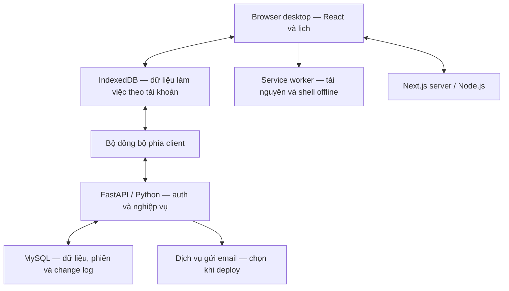

# DAYFORGE — kiến trúc kỹ thuật

Cập nhật: **28/10/2026 — T01–T03 hoàn thành thiết kế/hợp đồng**. Người dùng đã duyệt [Thiết kế T01](../tasks/t01/design.md), chọn **phương án B**. [T03](../tasks/t03/design.md) là nguồn chuẩn đã khóa giao thức dữ liệu/tài khoản/sync; thư viện phụ và lockfile tiếp tục ở T04. Các mô tả nền dưới đây được đọc cùng hợp đồng T03.

## 1. Các phương án đã xem xét

| Phương án | Cách làm | Đánh đổi và kết quả |
| --- | --- | --- |
| A — Next.js xuất tĩnh + FastAPI | Phục vụ giao diện build sẵn; FastAPI xử lý API; lưu cục bộ để dùng offline. | Ít runtime cần vận hành; giới hạn các tính năng cần Next.js server. Đã được cân nhắc, không được chọn. |
| **B — Next.js server + FastAPI** | Chạy Next.js bằng Node.js, FastAPI bằng Python, lưu trên MySQL; client vẫn có IndexedDB và service worker. | Thêm một runtime cần vận hành; có khả năng xử lý/render phía Next.js. **Người dùng chọn B trong T01.** |

Next.js hỗ trợ self-host bằng Node.js hoặc container. Với DAYFORGE, Next.js server chạy trong production; cách đóng gói cụ thể chọn ở T04/T29. [Next.js self-hosting](https://nextjs.org/docs/app/guides/self-hosting).

## 2. Cấu trúc đã chọn

Server hoạt động độc lập với máy tính cá nhân. Thiết bị khác vẫn truy cập và đồng bộ được khi máy cá nhân tắt, với điều kiện thiết bị đó kết nối được server. **AWS hoặc Oracle Cloud sẽ chọn khi deploy**, không còn là điều kiện phải quyết định ngay để chốt T01.

## 3. Ranh giới trách nhiệm

- **Next.js/React:** các màn hình tài khoản, hai lịch, widget, tương tác và điều hướng. Lịch làm việc đọc/ghi IndexedDB trên client để dùng offline.
- **FastAPI:** đăng ký theo phạm vi dùng riêng, xác minh email, đăng nhập/phiên, email khôi phục, kiểm tra quyền và tất cả mutation/sync nghiệp vụ.
- **MySQL:** dữ liệu đã đồng bộ, quyền sở hữu, phiên, token email dạng an toàn, operation chống lặp và luồng thay đổi.
- **Service worker:** cache tài nguyên/shell cần để mở lại offline. Không thay cơ sở dữ liệu nghiệp vụ.

Tài khoản và mutation nghiệp vụ có một nguồn xử lý trong FastAPI; Next.js không duy trì một hệ thống tài khoản hoặc cơ sở dữ liệu nghiệp vụ riêng song song. Reverse proxy đề xuất đưa web và `/api` về cùng origin, chỉ cho backend truy cập MySQL.

Chạy Next.js server không tự tạo khả năng offline. Shell phải mở được cả hai route khi mất mạng sau lần chuẩn bị đầu; không phụ thuộc việc server render lại mỗi lần. Không cache HTML/RSC/API chứa thông tin riêng thành dữ liệu dùng chung giữa tài khoản. T13 phải kiểm chứng hành vi thực tế của bản build Next.js được chọn. [Hướng dẫn PWA của Next.js](https://nextjs.org/docs/app/guides/progressive-web-apps).

## 4. Công nghệ phụ đề xuất

| Phần | Đề xuất | Trạng thái |
| --- | --- | --- |
| Ngôn ngữ client | TypeScript | Đề xuất |
| Routing | Next.js App Router chạy trên Node.js | Next.js server đã chọn; cấu hình route giao T02/T03 |
| Lưu cục bộ | Dexie + IndexedDB, tách dữ liệu theo chủ tài khoản | Đề xuất thư viện; offline là yêu cầu đã chốt |
| Offline shell | Service worker và Workbox, thử tương thích bản build ở T13 | Đề xuất |
| Giao diện | CSS Modules + CSS variables | Đề xuất |
| Motion và kéo thả | CSS/Motion, dnd-kit | Đề xuất |
| Backend | FastAPI, Pydantic, Uvicorn | FastAPI/Python đã chốt; phụ thuộc cụ thể giao T04 |
| Dữ liệu server | MySQL, SQLAlchemy, Alembic; cân nhắc PyMySQL đồng bộ | MySQL đã chốt; ORM/driver đề xuất |
| Kiểm thử | Pytest; Vitest/Testing Library; Playwright và kiểm tra trực tiếp trên browser desktop | Đề xuất công cụ |

Nguồn: [Dexie React](https://dexie.org/docs/Tutorial/React), [Workbox](https://developer.chrome.com/docs/workbox/modules/workbox-build), [Motion React](https://motion.dev/docs/react), [dnd-kit](https://dndkit.com/), [SQLAlchemy](https://docs.sqlalchemy.org/), [Alembic](https://alembic.sqlalchemy.org/en/latest/).

Chưa khóa phiên bản trước thử tương thích. Không cần thêm Redis, Celery, microservices hay WebSocket vào phạm vi hiện tại. Dexie thông thường không tự đồng bộ với FastAPI/MySQL; bộ sync vẫn phải xây.

## 5. Offline và cách tự đồng bộ

Đã thống nhất:

1. Lần đầu tải ứng dụng và đăng nhập/xác minh cần mạng. Thiết bị được chuẩn bị dữ liệu và shell cho tài khoản đó.
2. Khi offline, xem và chỉnh sửa dữ liệu cục bộ; ghi thay đổi cùng outbox trong một giao dịch.
3. Khi web đang mở, kết nối lại được server thì tự đồng bộ.
4. Khi mở lại web, tự gửi các thay đổi chưa gửi và nhận dữ liệu mới; nếu phiên hết hạn thì yêu cầu đăng nhập lại trước khi sync, giữ dữ liệu đang chờ.
5. Khi đóng hẳn trình duyệt, thay đổi chưa gửi chờ lần mở tiếp theo. Không đặt đồng bộ nền khi đóng làm yêu cầu của giai đoạn đầu.

Chỉ báo “Đã lưu trên máy” sau commit local, “Đã đồng bộ” sau xác nhận server. Retry có khoảng lùi; online chỉ là tín hiệu để thử kết nối. Một bộ đồng bộ điều phối nhiều tab.

Không ép reload hoặc xóa IndexedDB khi nâng cache. Browser có quyền quản lý/xóa dữ liệu site; persistent storage có thể được đề nghị và phải kiểm tra kết quả cấp. Không hứa lưu trữ trình duyệt chống được mọi trường hợp xóa/hỏng thiết bị. [MDN persistent storage](https://developer.mozilla.org/en-US/docs/Web/API/StorageManager/persist).

## 6. Tài khoản và email

**Đã chốt:** email làm tài khoản, có xác minh email, mật khẩu riêng, không Google. DAYFORGE vẫn dùng riêng; không tự mở thành sản phẩm nhiều người dùng.

**Các mặc định tài khoản đã được duyệt cùng T01; chi tiết thực hiện giao T03:**

- Chỉ email chủ sở hữu đã cấu hình được tạo tài khoản; đóng đăng ký công khai.
- Xác minh bằng liên kết email; có gửi lại xác minh, quên/đặt lại mật khẩu và ghi nhớ đăng nhập.
- FastAPI quản lý phiên; đề xuất cookie Secure, HttpOnly và SameSite phù hợp, có bảo vệ Origin/CSRF. Không đưa mật khẩu, token phiên hoặc token email vào bundle/log.
- Mật khẩu lưu bằng hàm băm dành cho mật khẩu; token xác minh/reset dùng một lần, có hạn và lưu dạng an toàn. Có giới hạn thử đăng nhập/gửi email. Chi tiết thuật toán, thời hạn, chống lạm dụng và phiên giao T03.
- Dữ liệu API và local được ràng buộc với chủ tài khoản. Hết phiên giữ pending edits của đúng chủ; đăng xuất khóa truy cập local và báo rõ nếu còn thay đổi chưa gửi. Không gửi outbox của tài khoản cũ bằng một phiên của tài khoản khác.

Các nguyên tắc mật khẩu/khôi phục tham khảo [OWASP Authentication](https://cheatsheetseries.owasp.org/cheatsheets/Authentication_Cheat_Sheet.html) và [OWASP Forgot Password](https://cheatsheetseries.owasp.org/cheatsheets/Forgot_Password_Cheat_Sheet.html). [Hợp đồng tài khoản T03](../tasks/t03/auth-contract.md) đã khóa Argon2id, cookie/session, token TTL, CSRF, khóa local và các giới hạn. Chưa triển khai tính năng.

Dịch vụ gửi email chọn ở T29/T30 cùng hạ tầng: có thể qua SMTP hoặc API nhà cung cấp. Phải cấu hình địa chỉ gửi, HTTPS callback và thử gửi/nhận email thật trước production; không mặc định một tài khoản cloud mới đã gửi được email xác minh. Không cần thêm luồng đăng nhập Google hay ghép mã thiết bị.

## 7. Xử lý xung đột

**Người dùng đã chọn tự giữ bản chỉnh sửa mới nhất.** Mốc so sánh dựa trên thời điểm chỉnh sửa đã ghi nhận; operation đến muộn không tự được coi là mới hơn. Không có luồng bắt người dùng chọn giữa hai bản để tiếp tục đồng bộ.

LWW không thay thế kiểm tra dữ liệu, quyền, revision, cursor hoặc chống retry. [Hợp đồng đồng bộ T03](../tasks/t03/sync-contract.md) khóa HLC/clock repair, tie-break, xóa–sửa, immutable intent replay và nhóm nguyên tử; [thiết kế dữ liệu](05-data-and-sync.md) giữ bối cảnh nghiệp vụ.

## 8. Deploy và các quyết định để sau

Đề xuất bắt đầu bằng một máy chủ Linux chạy Next.js server, FastAPI và MySQL, với reverse proxy HTTPS và dữ liệu bền. Có thể dùng container để dễ chuyển AWS/Oracle; không bắt buộc khóa công cụ trước T04/T29.

Ưu tiên cấu hình nhỏ, chi phí thấp. Do có cả Node.js, Python và MySQL, cấu hình mua phải dựa trên thử nghiệm bản build thực và đo bộ nhớ; chưa chốt 512 MB/1 GB hoặc một mức phí cố định. Build ở máy phát triển/CI để giảm tải server.

T29/T30 chọn nhà cung cấp/region, cấu hình, domain, dịch vụ email và backup. Cần migration, backup/restore đã thử, tự khởi động lại, health/log và rollback tương thích dữ liệu. Bản sao lưu server chỉ có dữ liệu đã đồng bộ.

Ghi phiên bản browser và hệ điều hành thực tế khi kiểm chứng trực tiếp.
