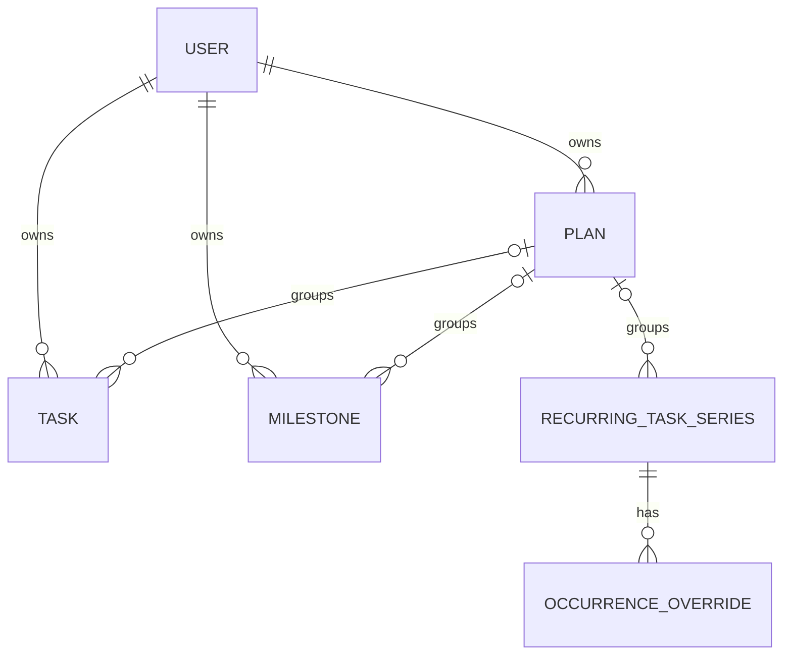

# DAYFORGE — dữ liệu và đồng bộ

Cập nhật **28/10/2026 — T01–T03 hoàn thành thiết kế/hợp đồng**. Người dùng đã duyệt chính sách trong [T01](../tasks/t01/design.md)/[T02](../tasks/t02/design.md). [Hợp đồng T03 1.0](../tasks/t03/design.md) đã khóa trường, API, auth và thuật toán; đó là nguồn chuẩn khi triển khai. Tài liệu này giữ nền yêu cầu và các đề xuất trước khi chi tiết hóa; tên thực thể logic không thay cho wire/schema T03.

## 1. Các nguyên tắc

- Backend FastAPI, MySQL, frontend Next.js server; lịch vẫn đọc/ghi cục bộ trên client khi offline.
- Mọi dữ liệu nghiệp vụ, operation và cursor có phạm vi chủ tài khoản; server suy ra quyền từ phiên đã xác thực, không tin `owner_id` client gửi.
- ID tạo trên thiết bị, đề xuất UUID; operation ID ổn định để retry an toàn.
- Ngày công việc/dấu mốc là ngày lịch `YYYY-MM-DD`; buổi là `morning`, `afternoon`, `evening`; không suy ra giờ bắt đầu từ vị trí thẻ.
- Thời lượng là số phút, đề xuất không bắt buộc. Màu mục có kế hoạch lấy từ kế hoạch.
- Đề xuất một múi giờ làm việc UTC+07:00 và tuần thứ hai–chủ nhật. T03 chốt biểu diễn và quy tắc ngày, không dựa vào múi giờ ngầm của server.
- Tách **thời điểm chỉnh sửa** để phân xử LWW khỏi **revision/cursor server** để xác nhận và đọc luồng thay đổi.

## 2. Thực thể logic

| Thực thể | Vai trò |
| --- | --- |
| `User` | Email duy nhất theo quy tắc chuẩn hóa đã định nghĩa, password hash, trạng thái đã xác minh. |
| `Session` | Phiên đăng nhập, hạn dùng và thu hồi; cookie chỉ mang định danh/thông tin xác thực theo thiết kế T03. |
| `EmailToken` | Xác minh/reset: mục đích, chủ sở hữu, hạn dùng, trạng thái dùng một lần và giá trị lưu an toàn. |
| `Plan` | ID, chủ tài khoản, tên, màu. |
| `Task` | ID, chủ tài khoản, tên, kế hoạch tùy chọn, ngày, buổi, thời lượng, thứ tự và trạng thái hoàn thành. |
| `Milestone` | ID, chủ tài khoản, tên, kế hoạch/màu, ngày, buổi tùy chọn, ghi chú liên quan, cờ hiện trên lịch công việc. Buổi và ghi chú là bổ sung của người dùng trong T02. |
| `RecurringTaskSeries` | Dữ liệu mẫu, các thứ lặp, ngày bắt đầu/kết thúc, buổi và các mặc định. |
| `OccurrenceOverride` | ID, series ID, ngày gốc, dữ liệu chỉnh riêng hoặc dấu loại một lần khỏi lịch. |
| `WorkspaceSettings` | Múi giờ và quy ước tuần cho không gian cá nhân của chủ tài khoản. |

Đây không phải DDL đã khóa. Trang ghi chú nhanh độc lập, phân quyền nhóm và tài khoản Google không thuộc đợt đầu. Ghi chú gắn trong dấu mốc đã được người dùng bổ sung vào đợt đầu trong T02. Chưa yêu cầu giao diện quản lý nhiều người dùng.

Các bản ghi sync có revision, metadata LWW và tombstone. Lưu kết quả `pending`/`completed`; trạng thái ngày đã qua chưa hoàn thành được tính theo ngày/múi giờ, không cần cron nửa đêm.

## 3. Quan hệ giữa hai lịch

**Đã chốt:** tạo dấu mốc riêng, không biến công việc thành dấu mốc hoặc tự tạo từ hạn công việc. Dấu mốc có thể thuộc kế hoạch. Hai lịch cùng đọc một `Milestone` nếu bật hiển thị; không sao chép thành hai bản ghi.

Dời “Ôn ABC” không dời “Thi giữa kỳ”. Sửa dấu mốc cập nhật cả hai nơi hiển thị; các công việc cùng kế hoạch vẫn có lịch riêng.

Buổi và nội dung ghi chú thuộc cùng bản ghi dấu mốc, cùng cơ chế local/outbox/LWW như tên/ngày. Đề xuất buổi không chọn biểu diễn bằng giá trị rỗng/null và ghi chú là văn bản nhiều dòng, không phải một thực thể note riêng. T03 khóa tên trường, giới hạn độ dài, chuẩn hóa xuống dòng và migration; không suy ra giờ cụ thể từ buổi. Dấu mốc cũ không có buổi/ghi chú phải tiếp tục đọc được.

## 4. Mô hình lặp và lịch sử

Lưu mẫu lặp và ngoại lệ, không sinh vô hạn dòng. Khai triển trong khoảng xem, gồm cả ngoại lệ có ngày đích trong khoảng dù ngày gốc ngoài khoảng. Một lần đã dời phải biến mất ở vị trí gốc và chỉ xuất hiện một lần ở đích.

Đề xuất định danh lần bằng series ID + ngày gốc, với ID override ổn định. Dời ngày không đổi danh tính lần. Phạm vi “từ lần này” theo ngày gốc là mặc định kỹ thuật đề xuất; giao diện phải thể hiện mốc đủ rõ khi lần đang chọn đã dời.

| Thao tác | Chính sách |
| --- | --- |
| Hoàn thành/dời/sửa/xóa một lần | Chỉ thay lần đó bằng override; không thay cả template. |
| Sửa quy tắc từ mốc chọn | Giữ lịch sử trước mốc; các lần tương lai đã chỉnh riêng tách thành task một lần, giữ ngày/buổi/nội dung/kết quả và kế hoạch/màu; phần còn lại theo quy tắc mới. |
| Dừng từ mốc chọn | Gỡ các lần từ mốc còn thuộc chuỗi, **kể cả đã dời riêng**; giữ lịch sử trước mốc và các task đã tách khỏi chuỗi từ trước. |

Quy tắc tách các lần tương lai đã chỉnh riêng áp dụng khi đổi lịch lặp, không chỉ khi weekday cũ không còn hợp lệ. Một lần đã xóa riêng vẫn giữ ý định loại bỏ; không biến dấu xóa thành một task sống. Cách xử lý ranh giới ngày gốc/ngày đích và các ngoại lệ trạng thái giao T03 định nghĩa thống nhất.

Tách series, giữ task một lần và chuyển/xóa ngoại lệ liên quan là một **giao dịch nghiệp vụ nguyên tử** ở client/server. ID các task tách phải ổn định qua retry; không tạo bản sao mới mỗi lần gửi lại.

## 5. Metadata đồng bộ

| Khái niệm | Vai trò |
| --- | --- |
| `OutboxOperation` | Thay đổi chờ gửi, ID, chủ tài khoản, đối tượng/nhóm, base revision, mốc chỉnh sửa và phụ thuộc. |
| `RecordedOperation` / `OperationReceipt` | Intent bất biến và xác nhận đã ghi; giữ cả operation thua/no-op để retry cùng kết quả receipt. Hiệu lực hiện hành được tính lại qua replay. |
| `ChangeLog` | Thay đổi đã commit theo cursor server trong phạm vi chủ tài khoản, gồm dấu xóa. |
| `ServerShadow` | Bản server cuối cùng đã biết, tách khỏi bản hiển thị còn thay đổi local. |
| Metadata LWW | Thời điểm sửa đã ghi và các thông tin để phân xử bằng quy tắc xác định. |

Revision/cursor không được dùng thay cho mốc chỉnh sửa chỉ vì một thiết bị gửi chậm. Không cần `SyncConflict` kèm màn hình người dùng tự chọn bản thắng như đề xuất cũ; có thể giữ chẩn đoán nội bộ tối thiểu theo thiết kế T03.

## 6. Luồng local, push và pull

1. Ghi thay đổi cùng outbox trong một giao dịch IndexedDB, đúng chủ tài khoản; chỉ báo lưu sau commit.
2. Điều phối một bộ sync giữa các tab. Gửi theo phụ thuộc, như tạo kế hoạch trước việc tham chiếu nó; nhóm sửa/dừng chuỗi gửi nguyên tử.
3. Server kiểm tra phiên, email đã xác minh, quyền sở hữu và dữ liệu; operation đã xử lý trả kết quả cũ.
4. Server phân xử LWW theo mốc chỉnh sửa đã ghi, áp dụng bản thắng và ghi dữ liệu/revision/change log/kết quả operation trong một giao dịch MySQL. Bản thua được xác nhận rõ là không thắng, không biến thành lỗi cần chọn thủ công.
5. Client ghi ACK và shadow trong giao dịch; bỏ operation đã được xác nhận, tái áp dụng các sửa mới hơn còn chờ để phản hồi trễ không đè mất chúng.
6. Pull sau cursor; áp dụng thay đổi và cursor nguyên tử. Nếu local còn bẩn, đối chiếu bằng cùng quy tắc LWW/shadow, không ghi đè mù bản mới hơn.
7. Retry giữ nguyên ID, nội dung và mốc sửa của operation đã gửi. Sửa tiếp là một operation mới, không đổi timestamp chỉ để bản cũ thắng.

Snapshot/cursor phải nhất quán. [T03](../tasks/t03/sync-contract.md) khóa owner sequence tới commit và dùng prefix event bất biến cho bootstrap/pull phân trang. ACK chỉ xác nhận event; không tự đẩy pull cursor hoặc ghi đè shadow. Nhóm chuỗi dùng typed intent replay, không thay snapshot cả family từ client.

## 7. Xung đột tự động — đã chốt LWW

Người dùng yêu cầu **tự chọn bản chỉnh sửa mới nhất**, không yêu cầu giải quyết bằng tay. Ví dụ một việc được sửa offline lúc A và lúc B, bản sửa có mốc mới hơn thắng khi đồng bộ; thứ tự thiết bị kết nối lại không tự quyết định kết quả.

Các yêu cầu dưới đây đã được chốt trong [T03](../tasks/t03/sync-contract.md); hành vi chạy thật phải kiểm chứng ở các task triển khai:

- Định nghĩa chính xác mốc sửa, nguồn thời gian, cách xử lý đồng hồ thiết bị lệch và quy tắc khi hai mốc bằng nhau; kết quả phải xác định và hội tụ trên mọi thiết bị.
- Chốt độ hạt LWW. Mặc định người viết đề xuất là một đối tượng nghiệp vụ, với sửa/dừng chuỗi là một nhóm nguyên tử; không tự trộn trường làm một việc có ngày/buổi không thuộc bản sửa nào.
- Xóa tham gia cùng thứ tự LWW. Bản sửa cũ không khôi phục một bản xóa mới hơn. Nếu một bản sửa thực sự mới hơn bản xóa thắng, hành vi phục hồi phải được định nghĩa rõ và kiểm thử.
- Không cho timestamp lỗi/vượt quá giới hạn hợp lệ áp đảo dữ liệu vô thời hạn; nếu không xác định được mốc hợp lệ thì giữ hàng đợi và báo lỗi kỹ thuật, không âm thầm bỏ dữ liệu.
- Không hứa biết chính xác thứ tự thực ngoài đời khi hai đồng hồ offline sai lệch. Cần một chính sách đo/hiệu chỉnh và giới hạn rõ; chi tiết này thuộc T03.

LWW có nghĩa chỉ bản thắng trở thành dữ liệu hiện hành; không còn cam kết giữ cả hai bản để người dùng chọn. Các bản ghi không liên quan vẫn sync bình thường khi một operation lỗi validation/quyền.

## 8. Xóa, hoàn tác và bootstrap lại

Gỡ khỏi lịch phản ánh ngay ở UI, server giữ tombstone với metadata LWW để thiết bị chậm nhận được kết quả xóa. Không dọn tombstone hoặc kết quả chống lặp sớm ở đợt đầu.

Nếu sau này cursor hết hạn, bootstrap giữ outbox đúng chủ, tải snapshot/cursor nhất quán và đối chiếu các operation còn chờ; không vứt chúng khi thay snapshot. Hoàn tác được ghi thành mutation mới có mốc sửa mới và kiểm tra quyền; không sửa ngầm lịch sử ACK.

## 9. Tài khoản, phiên và dữ liệu local

Đã duyệt email + xác minh email + mật khẩu riêng, không Google. Mô hình account/phiên/token cụ thể ở T03. Các mặc định bổ sung dưới đây đã được duyệt cùng bản tổng hợp T01:

- Chỉ email chủ sở hữu được cấu hình đăng ký; email chưa xác minh không được nhận quyền đọc/ghi/sync lịch.
- Lần đầu đăng nhập/xác minh/reset cần online. Sau đăng nhập hợp lệ, thiết bị tin cậy có thể mở dữ liệu đã lưu và sửa offline; sync cần phiên server hợp lệ.
- Hết phiên hoặc lỗi quyền không xóa pending edits. Đăng nhập lại đúng chủ để tiếp tục; đổi mật khẩu/reset phải xử lý thu hồi phiên theo thiết kế T03.
- IndexedDB, outbox, shadow và cursor tách theo tài khoản. Auth response/API riêng không bị service worker/Next cache dùng chung.
- Đăng xuất khóa truy cập local, cảnh báo khi có dữ liệu chưa gửi, giữ dữ liệu chờ trong phạm vi chủ để khôi phục sau đăng nhập; không âm thầm xóa hay gửi sang tài khoản khác. T03 định nghĩa rõ việc thu hồi phiên online và khóa cục bộ khi offline.

Không đồng bộ mật khẩu/token email/token phiên trong payload lịch hoặc log. Thu hồi phiên không thể xóa tức thì một bản local trên thiết bị đang offline; không đưa remote wipe vào phạm vi.

## 10. Hợp đồng API ở mức ý tưởng

| Nhóm | Mục tiêu |
| --- | --- |
| Tài khoản | Khởi tạo tài khoản chủ, gửi/xác minh/gửi lại email, đăng nhập/đăng xuất, quên/reset mật khẩu và phiên. |
| Bootstrap | Snapshot nhất quán cùng cursor theo chủ tài khoản. |
| Push | Operation/nhóm nguyên tử; trả kết quả applied hoặc superseded cùng revision/bản hiện hành và lỗi hợp lệ khác. |
| Pull | Đọc thay đổi theo cursor, phân trang và dấu xóa, giới hạn theo chủ. |
| Health/version | Khả năng kết nối và tương thích client/API. |

Không bổ sung hệ thống ghép mã thiết bị hoặc đăng nhập Google. [HTTP contract T03](../tasks/t03/api-contract.md) đã khóa schema, đường dẫn, mốc thời gian và lỗi cụ thể; mọi mutation lịch đi qua cùng lớp nghiệp vụ/log.

## 11. Bất biến

- Retry một operation chỉ có một tác dụng; operation thua LWW không thắng trở lại do retry.
- Mọi thiết bị hội tụ về cùng bản thắng; ACK/pull trễ không đè sửa local mới hơn.
- Một lần dời chỉ hiện một nơi; các task tách khỏi chuỗi không bị dừng chuỗi xóa theo.
- Hai lịch đọc cùng một dấu mốc; không tự tạo milestone từ task.
- Nâng cấp, bootstrap và hết phiên không âm thầm mất outbox.
- Phiên tài khoản A không đọc/ghi/sync hoặc nhận cache riêng của tài khoản khác.
